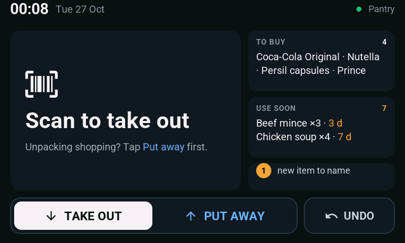
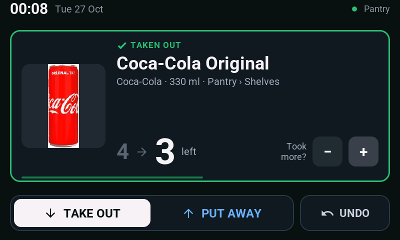
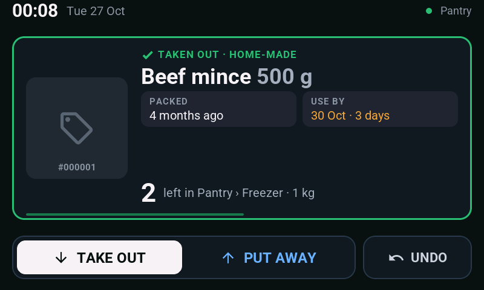
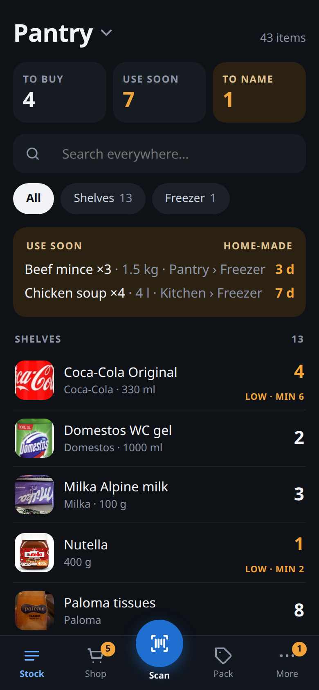
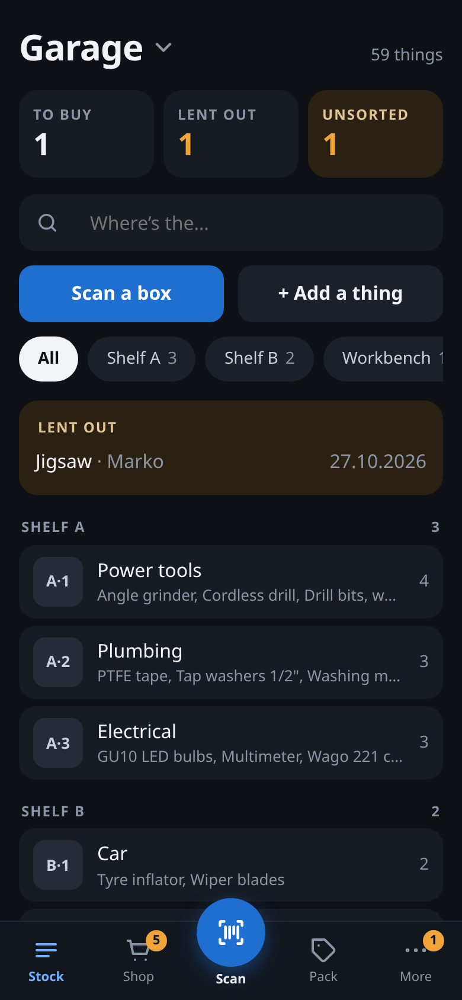
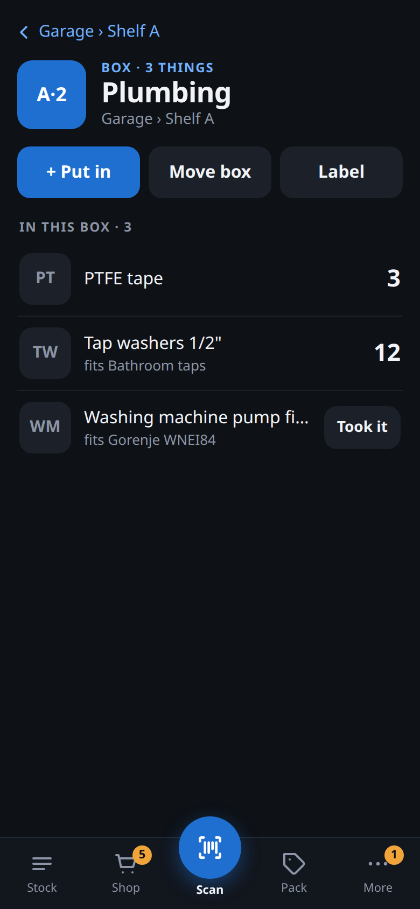
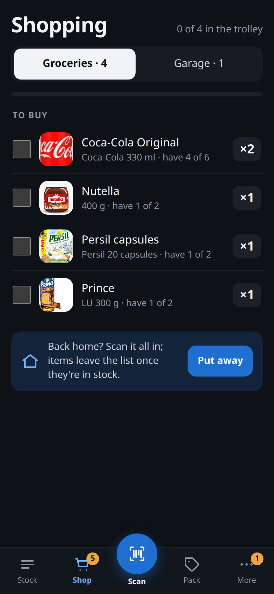
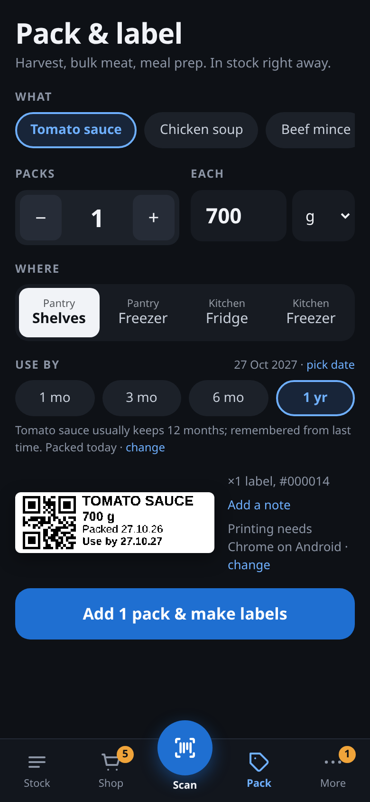

# Pantry

Self-hosted home inventory: pantry, fridge, freezer, garage, anything with a shelf.
Scan things **in** when you put them away and **out** when you use them, and always
know what you have.

- **Store-bought:** scan the product's own barcode (EAN/UPC). Name, brand and photo
  come from Open Food Facts, or for cleaners, toilet paper and toiletries from its
  sister databases Open Products Facts and Open Beauty Facts. Packs of the same
  product are counted together.
- **Home-made** (harvest, bulk meat, meal prep): *Pack & label* prints one QR label per
  package on a Bluetooth cat printer. Each package keeps its own weight, packed date
  and use-by date, and scanning it OUT removes that exact package.
- **Wall scanner:** ESP32-P4 4.3" touchscreen (Guition) + GM67 barcode module, ESPHome firmware
  (`esphome/`). TAKE OUT / PUT AWAY modes, product photo, count before → after,
  −/+ for multiples, QR to name unknown barcodes, offline queue, ambient night clock.
- **Phone PWA:** camera scanning, inventory, shopping list, inbox for unknown barcodes,
  history with undo. Pages still open offline, and offline scans are queued and replayed.
- **Home Assistant:** shopping list mirrored to a to-do list; `/api/summary` for sensors.

Stack: SvelteKit (adapter-node) + SQLite (`node:sqlite`, no native deps), one container.

## Screenshots

The wall scanner: waiting for a scan, a product taken out, a home-made package taken out.

<p>
  
  
  
</p>

The phone app: Pantry stock, the Garage, one box, the shopping list, packing and labelling home-made food.

<p>
  
  
  
  
  
</p>

## Run

```bash
cp .env.example .env     # set ORIGIN, optionally HA_*
docker compose up -d --build
```

Data (SQLite DB + cached product photos) lives in `./data` → `/data` in the container.

Dev: `npm install && npm run dev` (port 5190, data in `./data`).

### Environment

| Var | |
|---|---|
| `ORIGIN` | Public HTTPS URL behind your reverse proxy, e.g. `https://pantry.example.com`. SvelteKit form posts check it. |
| `DATA_DIR` | Defaults to `/data` in the image. |
| `TZ` | Time zone for History, e.g. `Europe/Ljubljana` (the default in `docker-compose.yml`). |
| `HA_URL`, `HA_TOKEN`, `HA_TODO_ENTITY` | Optional grocery-list sync, e.g. `http://192.168.10.10:20810`, a long-lived token, `todo.shopping_list`. |
| `HA_TODO_ENTITY_GARAGE` | Optional: the garage shopping list into its own HA to-do list, e.g. `todo.hardware_store`. |
| `HA_NOTIFY` | Optional: "Lent to…" reminders as phone notifications, e.g. `notify.mobile_app_pixel_8`. |

### Reverse proxy

The phone needs **HTTPS** for the camera, PWA install and Web Bluetooth. Proxy to port
5190. `/api/events` is a server-sent-events stream, so turn off response buffering for
it (nginx: `proxy_buffering off;`; the app also sends `X-Accel-Buffering: no`).

The wall scanner talks plain HTTP straight to `http://<nas>:5190`, not through the proxy.

**There is no login.** Keep the app LAN-only or put proxy auth in front of the HTTPS
side. The wall scanner bypasses the proxy, so proxy auth doesn't affect it.

## Spaces: Pantry, Kitchen, Garage

Storage is a small tree: **spaces** › **places** › **boxes**.

| Space | Places (at first) | Lists |
|---|---|---|
| **Pantry**, the home space | Shelves, Freezer | Groceries, *Use soon*. The wall scanner files here. |
| **Kitchen** | Fridge, Freezer | Groceries, *Use soon* (same lists as Pantry) |
| **Garage** | Unsorted (+ your shelves) | its own Garage shopping list |

- The **Stock** tab opens on Pantry; tap the title (*Pantry ▾*) to switch space.
  Search always looks **everywhere** and answers with the path,
  e.g. *Garage › Shelf A › A·1 Power tools*.
- Add spaces and places in **Settings → Spaces and places**. A space shops into either
  Groceries or the Garage list.
- **Boxes:** on a shelf's page, *+ New numbered boxes* makes A·1, A·2… and prints their
  labels on the P15 (QR `PNTRY:B:…`). Scanning a box label on the phone opens the box;
  *Move box* moves everything inside with it.
- **Sorting the garage:** open a box, *+ Put in*: snap a photo, name it, *Tool / Spare part
  / Other*, what a spare part **fits**, *Just 1* or *Count them*. *Save, next thing*.
  Not sure where something goes? Put it in *Unsorted* and move it later.
- **Counted** things (bulbs, filters, screws) have a quantity and a minimum, like food.
  **Located** things (a drill) only have a place: *Took it* / *Put back*, *Move…*,
  and *Lent to…* with a reminder (7 / 14 / 30 days) through Home Assistant.
- Migrating from before spaces: the old Pantry becomes *Pantry › Shelves*, Freezer
  *Pantry › Freezer*, Fridge *Kitchen › Fridge*; nothing else changes.

See `docs/storage-design.md` for the reasoning.

## Using it

The phone app looks and talks like the wall: dark, TAKE OUT / PUT AWAY, the same result
card. Tabs: Stock · Shop · **Scan** (the big middle button) · Pack · More.

| Screen | |
|---|---|
| **Stock** | Tiles for *to buy*, *use soon*, *to name*; search; filter by place; tap a count for −/+ |
| **Shop** | Groceries and Garage lists: below *min stock*, with photos. Ticks ("in the trolley") stay on your phone; *Put away* opens Scan in put-away mode |
| **Scan** | Camera (+ torch, + type a code), TAKE OUT / PUT AWAY (falls back after 2 min, like the wall), result card with −/+, undo, fix count, the trip list |
| **Pack** | Home-made goods: recent products as chips, packs × amount, where, use-by chips, live label preview → print |
| **Product** | Count per place, packages, details. An unknown barcode (the wall's QR code lands here) opens as a quick *name it* form |
| **More → Inbox** | Barcodes the Open Food Facts databases didn't know |
| **More → History** | By day, filter wall / phones / count issues, undo any of them |
| **More → Settings** | Locations, printer darkness + test print |

Set **Min stock** on a product to have it appear on the shopping list.
**Keeps (days)** pre-fills use-by when packing. It's learned from the first pack if blank.

### Label printers

Printing happens **from the phone over Web Bluetooth**: Chrome on Android, over HTTPS.
On the first print, Chrome lists nearby Bluetooth devices; pick the printer. The app
recognises which kind it is and draws the label for it. Choose the kind in **Settings** so
previews match before you've connected. Close the printer's own app first: these printers
take one connection at a time.

| | **P15** label maker (Marklife / Pristar P15, P12, L13) | **C15** "cat" printer (Fun Print) |
|---|---|---|
| Labels | 12–15 mm die-cut labels, 30 / 40 / 50 mm long (set in Settings) | 57 mm thermal sticker roll |
| Layout | QR across the full 12 mm height, name / amount / dates beside it | QR left, larger text right |
| Driver | `src/lib/p15printer.js`: service `0xFF00`, ESC/POS raster (`GS v 0`) in a `10 FF …` job | `src/lib/catprinter.js`: the `51 78 …` protocol (MX/GB models) |
| Darkness | fixed | slider in Settings |

The P15 job format follows what the [LaBLEr](https://github.com/toolicious/labler) project
verified on a P15 (our bytes match its reference job exactly). If a printer isn't
recognised, the error lists the Bluetooth services it does offer. Stick labels on dry bags
*before* freezing.

Labels encode `PNTRY:I:000123`. The wall scanner and phone camera both read them.

## Wall scanner (`esphome/`)

### Parts

Everything is off the shelf; no custom board needed. Prices are AliExpress, delivered to
Slovenia, VAT included (October 2026); [hardware/shopping-list.md](hardware/shopping-list.md)
has the listings, quantities and the small stuff.

| | |
|---|---|
| Guition **JC4880P443C** (ESP32-P4 + ESP32-C6 for Wi-Fi, 4.3" 480×800 IPS used in landscape, GT911 capacitive touch) | ~€34 |
| **GROW GM67** barcode module (1D + 2D, red aiming light, 5 V, TTL UART; comes with its cables). The [enclosure](hardware/enclosure) is made for it; a GM65 or the SparkFun breakout works with the same firmware. | ~€18 + shipping |
| **Speaker**, 8 Ω 1–2 W, round 28 mm × 5 mm, with a 1.25 mm 2-pin plug: it plugs into the board's own amplifier | ~€2.50 |
| **WS2812B LED module**, a single LED (DIN, VCC, GND) | ~€1 |
| A 1.25 mm 4-pin pigtail for CN2, three female Dupont wires, a **right-angle** USB-C cable and a 5 V 2 A supply | ~€5 |
| [3D-printed case](hardware/enclosure) (or any wall box) | |

The speaker and LED are optional: without them, drop the `feedback` package and the
speaker section from `pantry-scanner.yaml`.

### Wiring

| Guition | Goes to |
|---|---|
| **CN2 "UART0"** (1.25 mm 4-pin) pin 1 `VIN` (5 V) | GM67 UART pin 1 `5V` |
| **CN2** pin 2 `TX` (GPIO37) | GM67 pin 3 `RX` |
| **CN2** pin 3 `RX` (GPIO38) | GM67 pin 2 `TX` |
| **CN2** pin 4 `GND` | GM67 pin 4 `GND` |
| **Speaker socket** (1.25 mm 2-pin, on the board's top edge) | speaker |
| **JP1** (2×13 header) pins **2, 4, 6**: 3.3 V, GND, GPIO33 | LED VCC, GND, DIN |

Both 4-pin connectors have the same pin order, so **TX and RX must cross**: a straight
cable between them won't work. Join a 1.25 mm pigtail from CN2 to the GM67's own UART cable
with pins 2 and 3 swapped (solder and heat-shrink). The GM67's UART socket is the one
marked UART, next to the USB one.

The LED takes three neighbouring header pins, so it's one 3-pin Dupont plug and no
splicing. It runs on 3.3 V so its data input sees a full-level signal; WS2812B LEDs are
rated from 3.5 V but work at 3.3 V. The speaker is driven by the board's ES8311 audio chip
and amplifier (enabled on GPIO11); the scan sounds are the same tunes a buzzer would play.

Flashing and logs go over the USB-C marked **full speed** (the ESP32-P4's USB
Serial/JTAG), so the scanner keeps UART0 and can stay plugged in.

**Other boards.** [esphome/pantry-sunton.yaml](esphome/pantry-sunton.yaml) is the same
thing on the Sunton **ESP32-8048S043C** (ESP32-S3, ~€52 delivered), with its wiring in the
file's header. Two optional custom boards, neither needed:
[hardware/scanner-carrier](hardware/scanner-carrier) sits behind the Sunton with sockets for
the scanner, a buzzer and a status LED; [hardware/mainboard](hardware/mainboard) replaces it
with one 4-layer board for the bare panel ([esphome/pantry-mainboard.yaml](esphome/pantry-mainboard.yaml)).

### Scanner module setup

Using the configuration barcodes in the scanner's manual (the
[GM67 manual](https://makerselectronics.com/wp-content/uploads/2026/07/GM67-Barcode-Reader-Module-User-Manual-V1.3.pdf)):
**serial (UART) output, 9600 baud, induction/continuous mode, add CR suffix**, and make
sure QR codes are enabled. The GM67 also beeps by itself on every read; its **silent mode**
leaves the beeping to the speaker, which sounds different for each result.
(Or keep its baud rate and change `scanner_baud` in `pantry-scanner.yaml`.)

### Flash

```bash
cd esphome
cp secrets.example.yaml secrets.yaml   # Wi-Fi, API key: openssl rand -base64 32 (OTA uses it too)
# edit substitutions at the top of pantry-scanner.yaml: server URL, location name
docker run --rm -it -v "$PWD":/config --device /dev/ttyACM0 esphome/esphome run pantry-scanner.yaml
```

The first flash prints the chip's revision (`Chip is ESP32-P4 (revision v…)`). Below
v3.0 it's an early chip: set `engineering_sample: "true"` in `pantry-scanner.yaml` and
flash again. After that, update over Wi-Fi.

Or use the ESPHome dashboard in Home Assistant: copy `pantry-scanner.yaml`,
`pantry-ui.yaml` (the screens), `pantry-feedback.yaml` (LED and scan sounds) and `pantry_ui.h`
into its config folder. The board shows up in HA with a backlight light
and a "Last scan" sensor, and takes its clock from HA, so it needs no internet.

**Wi-Fi co-processor.** The P4 has no radio; Wi-Fi is the ESP32-C6 beside it. These boards
ship with an older C6 firmware than ESPHome expects, which can drop Wi-Fi now and then.
Once the scanner is in HA, install the **Wi-Fi co-processor** update it offers (ESPHome's
build, downloaded by the scanner itself).

Set `ORIGIN` on the server: the unknown-barcode screen shows a QR code of
`<ORIGIN>/product/<id>`, which opens the product on your phone to name it.

The config is validated and compiles against ESPHome 2026.10 (RAM 16%, flash 24%), but
hasn't run on a board yet. The display and Wi-Fi settings are ESPHome's own for this board
(`model: JC4880P443`, ESP-Hosted over SDIO) and the pins come from its schematic notes.
If the picture is upside down, set `rotation: "270"`. Touch is polled, because the
sources disagree on its reset and interrupt pins.

### Try it without the hardware

`pantry-sim.yaml` runs the same screens in an 800×480 window on a Linux desktop (X11).
The mouse is the touchscreen, and a small script stands in for the barcode module.
It talks to the app on `http://127.0.0.1:5190`, so start that first (`npm run dev`).

```bash
esphome/sim/run.sh                   # builds a Docker image with SDL, compiles, opens the window
esphome/sim/scan 3017620422003       # "scan" a barcode (Nutella); PNTRY:I:000001 for a label
```

The first build takes a few minutes. Set `ORIGIN` in `.env` to see the QR code on
the unknown-barcode screen. The backlight does nothing in the window, so the night screen
shows at full brightness.

**Network:** if the scanner lives on the IoT VLAN, the router needs an allow rule from
it to the NAS on TCP 5190.

### On the wall

The screen has a status bar on top (clock, or a blue "PUTTING AWAY" band), a card in the
middle, and a fixed bottom bar: **TAKE OUT | PUT AWAY** and **UNDO**.

- **Take out** is the default. Scan anything you take: the card shows the photo,
  **3 → 2 left**, and goes back to the home screen (what to buy, what to use soon,
  items to name) after 8 seconds. Took two? Tap **+**.
- **Put away** before unpacking shopping. The top bar turns blue and counts down; after
  2 minutes without a scan it falls back to take out. Each scan shows **2 → 3** and lands
  in the *This trip* list. Bought six of the same? Scan one, tap **+** five times.
- **First time a barcode is seen:** "Looking it up…" while the server asks Open Food
  Facts in the background. If it isn't found, the screen shows a **QR code**: point
  your phone at it to name the product right away, or do it later from the inbox.
- **Took the last one:** an amber banner says so, and whether it's on the shopping list
  (set *Min stock* on the product for that).
- **Home-made package:** packed date, use-by, what's left, and a hint if an older pack
  should be used first.
- **Nothing in stock** (counts drifted): *It was there, fix count* records the one the
  app didn't know about.
- **UNDO** opens a list of this scanner's last 5 scans from the past day, newest on top.
  Tap the one to reverse (any −/+ on it is reversed too); **CLOSE** or 20 s without a
  tap closes the list.
- **Server unreachable:** keep scanning. Scans wait on the scanner and are sent when the
  server is back (kept in RAM, so a power cut loses them).
- After 5 minutes without a touch or scan it shows a dim clock with what to buy and use
  soon; a touch or scan wakes it.

## Home Assistant

Shopping list: set the `HA_*` variables. The app adds and removes only the items it put
there, so items you add by hand are left alone.

Sensors from `/api/summary`:

```yaml
rest:
  - resource: http://192.168.10.10:5190/api/summary
    scan_interval: 300
    sensor:
      - name: Pantry low stock
        value_template: "{{ value_json.low_count }}"
        json_attributes: [low]
      - name: Pantry use soon
        value_template: "{{ value_json.expiring_count }}"
        json_attributes: [expiring]
      - name: Pantry inbox
        value_template: "{{ value_json.inbox_count }}"
```

## API

| | |
|---|---|
| `POST /api/scan` `{code, mode: "in"\|"out", device?, location?, default_location?, async_lookup?}` — `location` forces a place, `default_location` only applies to products without a usual place, `async_lookup` answers at once and looks a new barcode up in the background | → `{status: ok\|lookup\|unknown\|empty\|error, title, detail, count, prev, units, meta, image, qr, last_one, pkg, use_by, older, product_id, event_id, …}` (see `scanReply` in `inventory.js`) |
| `GET /api/scan/:event` | The same reply for an earlier scan; the wall polls it while `status` is `lookup` |
| `POST /api/scan/:event/adjust` `{by: 1\|-1}` | One more or one fewer of that scan ("bought six") |
| `POST /api/scan/:event/fix` | For a nothing-in-stock OUT: record that there was one |
| `GET /api/scan/recent?device=wall` | That device's last 5 scans from the past day that can still be undone (the wall's UNDO list) |
| `POST /api/undo` `{event_id?}` | Undo that event, or the latest one |
| `GET /api/summary` | `{low_count, low[], expiring_count, expiring[], soon[{name, n, days}], inbox_count, garage_low_count, lent_out, overdue[]}` (`low` is groceries) |
| `GET /api/labels?ids=1,2` | Label data for reprinting |
| `GET /api/events` | SSE stream: `change` whenever stock moves |
