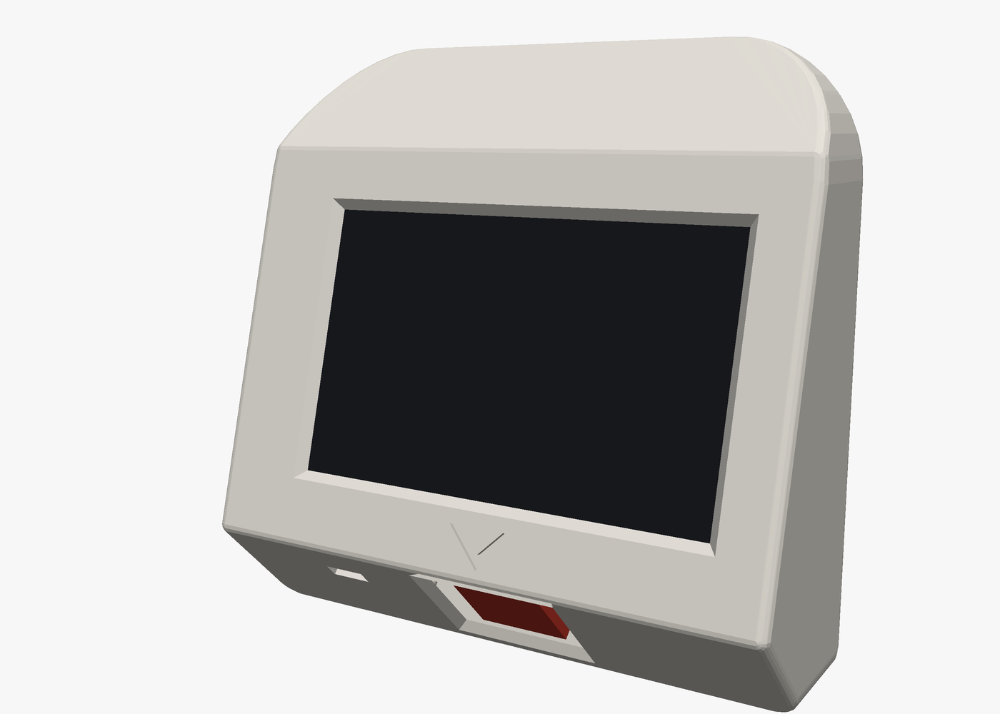
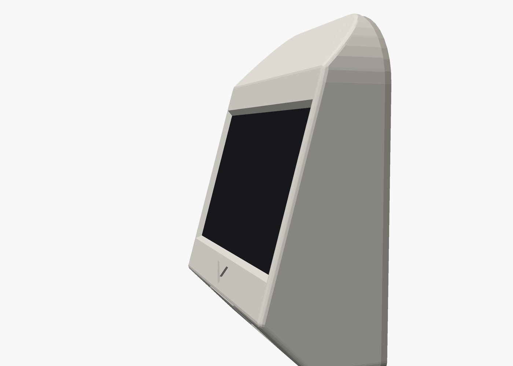
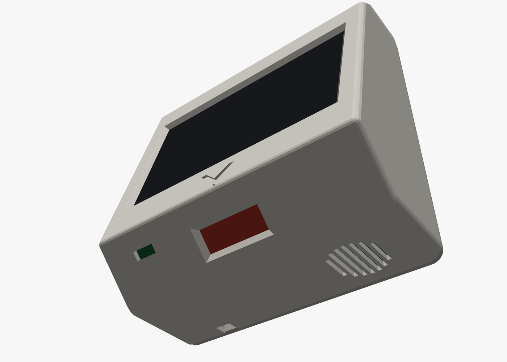
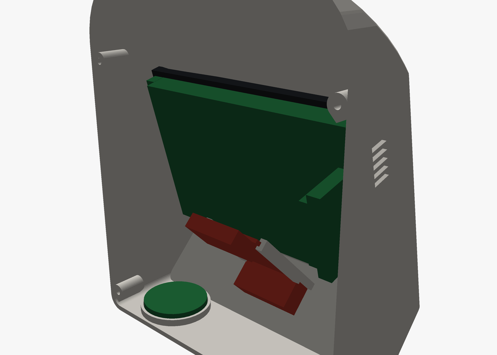
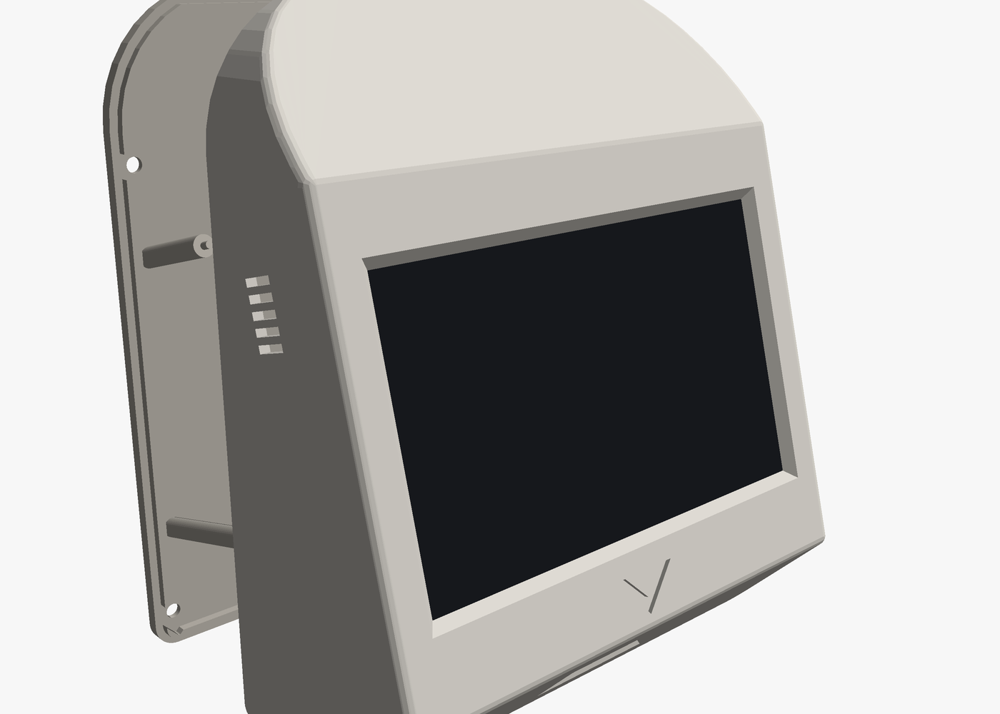

# Wall scanner enclosure

A printable case in the style of a shop price checker (like the Champtek SG-15), for the
Guition JC4880P443C (ESP32-P4) display board as it comes, a GROW GM67 barcode scanner,
a small speaker and a WS2812B LED module. No custom board. (For the Sunton, the
optional [mainboard](../mainboard) or the SparkFun scanner, see
[Other boards and scanners](#other-boards-and-scanners).)



| | |
|---|---|
|  |  |
| The screen face tilts up 15° toward you | The scanner looks down and forward through the bevelled "mouth"; the slit beside it is the status light, the round grille in the floor is the speaker's |
|  |  |
| Inside, back plate off: the board behind its screen with the plugs on its header and USB-C, the scanner in the mouth, the LED module and the speaker on the floor | Back plate: keyholes, and posts that hold the board by its mounting ears |

Outside about **122 wide × 148 high × 59 deep** (mm, including the back plate).

## The shape

Seen from the side it has five faces:

- **Back**, flat on the wall.
- **Top**: a 45° bevel.
- **Screen face**, tilted 15° up toward you. Below the screen it continues as a chin with
  an engraved arrow pointing down at the scanner.
- **Mouth**: a 45° bevel under the chin with the scanner window. The scanner looks 45°
  forward of straight down, where you'd hold a product, like at a shop's price checker.
- **Bottom**, flat.

Seen from the front the top corners are rounded (30 mm), the bottom ones slightly.

## Parts

| File | Print |
|---|---|
| [stl/pantry-scanner-shell.stl](stl/pantry-scanner-shell.stl) | Everything but the back. **Stands on its flat bottom, no supports**: every face is within 45° of vertical, and the windows' edges are chamfered so the screen window's top edge isn't a 100 mm bridge. PETG or PLA, 0.2 mm layers, 3 walls. |
| [stl/pantry-scanner-back.stl](stl/pantry-scanner-back.stl) | Back plate. Outside face down, posts up, no supports. |

Also: 4 × **M3 × 8** self-tapping screws (or machine screws into heat-set inserts), 2 wall
screws with heads up to 8 mm, thin double-sided foam tape, a little hot glue, a
**right-angle USB-C cable**, and Dupont wires for the modules (wiring:
[main README](../../README.md#wiring)).

## Assembly

1. **Display**: stick it into the shell, glass against the bezel, with a few strips of foam
   tape. Its two USB-C ports and the 2×13 header go to the left (as you look at the
   screen).
2. **Scanner**: two rails stand in the mouth along the scanner's line of sight. Slide the
   GM67 into their grooves from behind, scan engine first and its parts facing the floor,
   until the engine sits against the window. A dab of hot glue on each rail keeps it there.
   Plug its UART cable in first: there's room for the plug at the far end, not for fingers.
3. **LED module**: hot-glue it inside the mouth over the slit left of the scanner window,
   LED facing the slit.
4. **Speaker**: drop it into the ring on the floor, cone down over the round grille (right
   of centre, seen from the front), and fix it with a dab of hot glue. Its lead goes up to
   the speaker socket on the board's top edge.
5. **Wires**: the scanner's to CN2 "UART0", the LED's to the header.
6. **USB**: the board's USB-C ports face backwards, so plug a right-angle USB-C cable into
   the one marked full speed and lay its cable down to the notch at the back of the floor
   (left of centre). It leaves the case there and hangs down the wall.
7. **Close**: back plate on (its posts land on the display's four mounting ears, pins in
   their 2 mm holes), four screws, hang it on the two wall screws.

## Other boards and scanners

`scanner = "sparkfun"` puts back the mount for the SparkFun 2D Barcode Scanner (v1, DE2120):
it lies on two pegs in the mouth, and the case is 3 mm shallower.

`board` at the top of [pantry-scanner.scad](pantry-scanner.scad) also takes:

- `"sunton"`: the Sunton ESP32-8048S043C, with a buzzer module on the floor over five
  vents instead of the speaker. 138 mm wide: its board
  is wider than its screen, and its USB-C and P1 face the left wall with room for P1's
  plug, so the screen sits 4.5 mm right of centre. USB-C goes through the left wall.
  [stl/sunton-shell.stl](stl/sunton-shell.stl), [stl/sunton-back.stl](stl/sunton-back.stl).
- `"mainboard"`: the [mainboard](../mainboard) behind a bare panel: 111 mm wide, the LED
  shines down from the board onto the slit, the buzzer sounds through vents in the left
  wall, and the scanner plugs into the board's J4 with a 6-wire Dupont cable.
  [stl/mainboard-shell.stl](stl/mainboard-shell.stl),
  [stl/mainboard-back.stl](stl/mainboard-back.stl).

## Changing it

[pantry-scanner.scad](pantry-scanner.scad) is parametric OpenSCAD: the board, the panel's
size and thickness, the room beside the board, the screen tilt, the mouth's angle, chin
height, depth, corner radii and where the scanner, LED and speaker go are variables at the
top. Then:

```bash
hardware/enclosure/render.sh
```

exports the STLs and the pictures (Docker for OpenSCAD; the pictures come from
[render.py](render.py), a small renderer that needs only Python and Pillow).

Checked in OpenSCAD, for all three boards: the panel, board, scanner and module stand-ins and
the back plate don't intersect the shell (only touch where they should), including the
plugs on the Guition's header and USB-C and the Sunton's in P1 and P4.

## Not verified yet

Nothing has been printed. The Guition's glass (117.01 × 69.41 × 4.8 mm), its mounting
holes (Ø2 on 108 × 60 mm, in ears 5 mm behind the glass) and its depth (13.8 mm in all)
come from the maker's spec sheet; where the USB-C ports and the header sit is read off its
drawing, and the picture is taken to be centred in the glass. Measure yours and adjust
`panel_*`, `win`, `pcb_*` and `pcb_holes` before printing; `depth_top` leaves about 20 mm
behind the board for the Dupont plugs and the USB plug. The GM67's size (27.5 × 46.5 mm,
14 mm tall) and its engine's front (28 × 12 mm) come from GROW's manual; that the engine sits
flush with the board's end, and how far its plug sticks out, are read off the photo. Check
`gm_*` against yours. For a SparkFun v2 (SparkFun's replacement for v1, a different scanner
engine), check its size against `sf_w`, `sf_d` and the two mounting holes.
