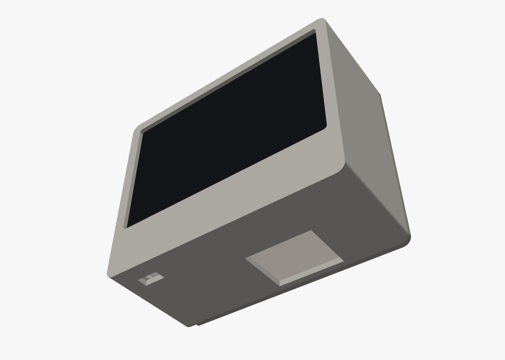

# Wall scanner enclosure

A two-part printable case for the [mainboard](../mainboard) behind a 4.3" 800×480
capacitive panel, with the SparkFun 2D Barcode Scanner looking down.


| | |
|---|---|
|  |  |
| Bottom: scanner window and the status-light slot | Inside, back plate off: board behind the panel, scanner lying flat |


Outside about **111 × 90 × 50 mm**, or about 42 mm deep without the scanner socket (see *Thinner*, below).

## Parts

| File | Print |
|---|---|
| [stl/pantry-scanner-front.stl](stl/pantry-scanner-front.stl) | Front shell: bezel, walls, chin. Face down, no supports. PETG or PLA, 0.2 mm layers, 3 walls. |
| [stl/pantry-scanner-back.stl](stl/pantry-scanner-back.stl) | Back plate. Outside face down, no supports. |

Also: 4 × **M3 × 8** self-tapping (or machine screws into heat-set inserts), 2 wall screws
with heads up to 8 mm, and thin double-sided foam tape for the panel.

## What's where

- **Front:** the panel drops in from behind against a 2.5 mm lip that covers the glass edge.
- **Chin**, under the display: the LD2410C radar slides between two rails on the inside of
  the chin face and looks forward through 2 mm of plastic. Print the front in a plain
  (not metallic or carbon-filled) filament so the radar can see through it.
- **Bottom:** the scanner window (the SparkFun module hangs right above it) and a slot where
  the side-view status LED glows down.
- **Left side:** USB-C. The back plate has a channel to lead the cable down the wall.
- **Top:** vents over the buzzer.
- **Back plate:** four posts press the board's corners against the panel (pins locate in the
  board's holes, so nothing screws into the board); four M3 screws hold it to the shell;
  two keyholes hang the whole unit on the wall.

## Assembly

1. Stick the panel into the front, glass against the lip, with a few strips of foam tape.
2. Plug the panel's two ribbons into the board (they wrap around the board's bottom edge),
   lay the board on the panel's back, ESP32 antenna at the top.
3. Plug in the scanner (right-angle header into J4, module facing down) and the radar cable;
   slide the radar between the chin rails, antenna side forward.
4. Close with the back plate (posts on the board's corners) and the four screws.

## Changing it

[pantry-scanner.scad](pantry-scanner.scad) is parametric OpenSCAD: panel size and thickness,
lip, wall, chin height, scanner window and radar position are variables at the top. Then:

```bash
hardware/enclosure/render.sh
```

exports both STLs and the pictures (Docker for OpenSCAD; the pictures come from
[render.py](render.py), a small renderer that needs only Python and Pillow).

**Thinner:** `scanner_socket = false` assumes the scanner's right-angle header is soldered
straight into the board instead of plugged into a socket, which saves 8.5 mm of depth.

## Not verified yet

Nothing has been printed. The panel outline (105.5 × 67.2 mm) and thickness are typical
for these panels; measure yours and adjust `panel_w`, `panel_h`, `panel_t` before printing.
The scanner window position follows from the board and the SparkFun drawing; it's large
(30 × 24 mm) to forgive a few millimetres.
