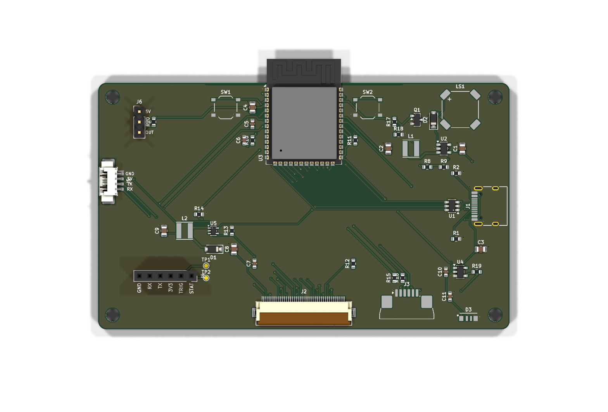

# Wall scanner mainboard

Everything for the wall scanner on one board: it replaces the Sunton ESP32-8048S043C.
A 100 × 60 mm, 4-layer board that sits behind a bare 4.3" 800×480 RGB panel; every part
is on the back, so JLCPCB assembles one side only. Goes into the
[printable enclosure](../enclosure).



- **ESP32-S3-WROOM-1-N16R8** (16 MB flash, 8 MB PSRAM), antenna over the top edge.
- **USB-C** is the ESP32-S3's native USB: power, flashing and logs. ESD protected (USBLC6),
  works with USB-C chargers (5.1 k CC pull-downs).
- **3.3 V**: SY8089 buck, 2 A.
- **Display**: 40-pin 0.5 mm ribbon (Hirose FH12, bottom contact), 16-bit RGB like the
  Sunton. The ESP32-S3 can put these signals on any GPIO, so they're assigned in the order
  they meet the module's edge seen from the connector: the 20 display lines reach it
  without crossing (with the Sunton's pin order they'd cross about 90 times).
  **Backlight**: TPS61169 constant-current boost (about 20 mA, 37.5 V limit), PWM from IO5.
- **Touch**: GT911 on a 6-pin 1.0 mm ribbon; IO39 SDA, IO40 SCL, IO41 INT, IO42 RST.
- **Scanner** on UART0 (IO43/44), which is free because flashing goes over USB:
  - **J4**: SparkFun 2D Barcode Scanner Breakout (DE2120, red aiming line), 3.3 V, on a
    1×6 socket. Solder a **right-angle** header to the SparkFun board so it lies flat behind
    this board, module facing down.
  - **J5**: any 5 V UART module (GM65, GM805, GM861…) on a 4-pin 1.25 mm cable instead.
  Fit only one.
- **Buzzer** MLT-8530 (IO2), **status LED** side-view SK6812 on the bottom edge shining
  down (IO1, level-shifted to 5 V), **radar** HLK-LD2410C on a 3-pin cable (OUT → IO4).
- **RESET** and **BOOT** buttons (rarely needed: USB flashing doesn't need them).

## Files

| | |
|---|---|
| `fab/mainboard-gerbers.zip` | Gerbers + drill files for JLCPCB: **4 layers**, 1.6 mm |
| `fab/bom-jlcpcb.csv`, `fab/cpl-jlcpcb.csv` | Parts and placement for JLCPCB assembly (LCSC numbers, in stock Oct 2026) |
| `fab/mainboard-schematic.pdf` | Schematic |
| `fab/mainboard.step` | 3D model |
| `mainboard.kicad_*` | KiCad 10 project |

## Ordering (JLCPCB)

1. Upload the Gerber zip, choose **4 layers** (the inner two are a ground and a 3.3 V plane).
2. PCB Assembly, top side, upload the BOM and CPL.
3. Check the placement preview, especially U2/U4 (SOT-23-5), U5 (SC-70-5), the two ribbon
   connectors, D3 (side LED, light toward the bottom edge) and LS1 (`+` top left).
4. J4 (1×6 socket) and J6 (radar header) are through-hole: let JLCPCB fit them or solder them.

## Panel

Any 4.3" 800×480 RGB TFT with the common 40-pin pinout (LED−, LED+, GND, VDD, R0–R7,
G0–G7, B0–B7, GND, DCLK, DISP, HSYNC, VSYNC, DE, NC, GND, 4 × resistive touch) and a
GT911 capacitive touch on a separate 6-pin 1.0 mm ribbon (GND, SDA, SCL, RST, INT, VDD):
the panel the Sunton boards use. Both ribbons wrap around the board's bottom edge into
the connectors on the back.

## Firmware

[esphome/pantry-mainboard.yaml](../../esphome/pantry-mainboard.yaml): the same screens
(`pantry-ui.yaml`) and the buzzer / LED / radar package (`pantry-feedback.yaml`) as the
Sunton build with the carrier, on this board's pins (the display block lists this board's
RGB GPIOs; the panel timing is unchanged). Flash it over USB-C the first time, over Wi-Fi
after that.

## Rebuilding

Everything comes from [tools/design.py](tools/design.py):

```bash
hardware/mainboard/tools/build.sh
```

Same steps as the [scanner carrier](../scanner-carrier#rebuilding), with a bigger router:
the USB-C escape (a fixed pattern in `design.py`: D+ joins on top, D- through two vias)
and the USB nets first, then a via for every ground and 3.3 V pad into the inner planes,
then everything else by negotiated congestion (PathFinder): nets may overlap at first, at
a price that rises each round, until none do. The strips behind the ribbon connectors are
left to the ground pour, which picks up their fine-pitch ground pins. About 10 minutes.

## Not verified yet

Nothing has been built. KiCad's checks are clean (see the build log), but:

- **The panel ribbon's contact side and pin 1 end** are the part most likely to be wrong for
  a given panel. Both connectors are bottom-contact (the ribbon's contacts face the board
  after it wraps around the edge) and have **pin 1 at the left end seen from the back of
  the board** (the right end seen from the front). Check your panel's drawing: its ribbon
  must arrive that way round, or the connectors need turning in `tools/design.py`.
- **Backlight current**: R13 = 10 Ω gives about 20 mA. Some panels want 40 mA (two strings):
  then use 5.1 Ω.
- The side LED's footprint is drawn from its datasheet (KiCad doesn't have it).
