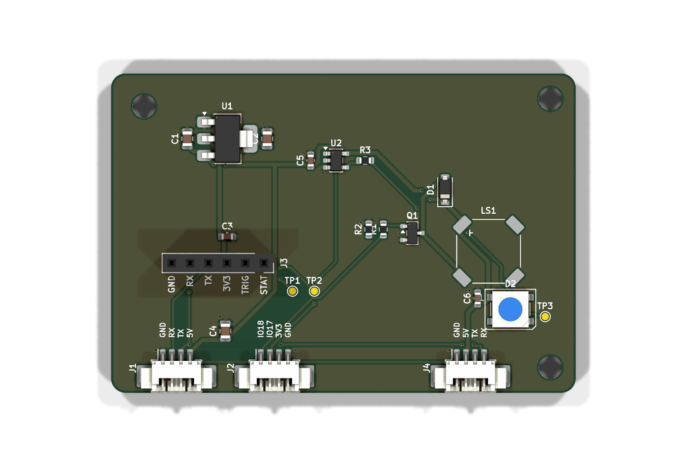

# Scanner carrier board

A 64 × 44 mm two-layer board that sits behind the Sunton ESP32-8048S043C and
adds a scanner socket, a buzzer and a status LED. Optional: the same parts as
off-the-shelf modules wired straight to the Sunton need no board at all (see the
header of [pantry-sunton.yaml](../../esphome/pantry-sunton.yaml)); this is the tidier
version for a box of your own (the [printable enclosure](../enclosure) is laid out for
the modules):

- **SparkFun 2D Barcode Scanner Breakout** (DyScan DE2120): the red aiming line,
  reads EAN/UPC *and* the QR labels. It plugs into a 1×6 socket and an M3 standoff.
  A GM65/GM861 still fits on the 4-pin **GM65** socket instead (fit only one scanner).
- **Buzzer** (MLT-8530, driven from 5 V): beeps you can hear through a case.
- **Status LED** (WS2812B): green taken out, blue put away, amber new barcode, red problem.



Everything here is generated from [tools/design.py](tools/design.py), the one
place parts, nets and positions are written down. See [Rebuilding](#rebuilding).

## Files

| | |
|---|---|
| [fab/scanner-carrier-gerbers.zip](fab/scanner-carrier-gerbers.zip) | Gerbers + drill files: upload this to JLCPCB |
| [fab/bom-jlcpcb.csv](fab/bom-jlcpcb.csv), [fab/cpl-jlcpcb.csv](fab/cpl-jlcpcb.csv) | Parts list and placement for JLCPCB assembly (LCSC numbers, all in stock Oct 2026) |
| [fab/scanner-carrier-schematic.pdf](fab/scanner-carrier-schematic.pdf) | Schematic |
| [fab/scanner-carrier.step](fab/scanner-carrier.step) | 3D model, for designing the case |
| `scanner-carrier.kicad_pro` / `.kicad_sch` / `.kicad_pcb` | The KiCad 10 project, if you want to open or change it by hand |

## Ordering (JLCPCB)

1. Upload `fab/scanner-carrier-gerbers.zip`. Defaults are fine: 2 layers, 1.6 mm,
   HASL. The rules are inside JLCPCB's standard process: 0.25 mm tracks, 0.2 mm
   clearance, 0.3 mm vias.
2. Turn on **PCB Assembly**, top side, and upload `bom-jlcpcb.csv` and `cpl-jlcpcb.csv`.
3. **Check the placement preview.** KiCad and JLCPCB don't always agree on which
   way a part faces; the ones worth a look are U1 (SOT-223), U2 (SOT-23-5), D2 (the
   LED: its marked corner must land on the pad KiCad marks as pin 1), the three 1.25 mm
   sockets (openings toward the board edge) and LS1 (`+` corner top left). Rotate any that are off right there.
4. The 1×6 socket (J3) is through-hole: let JLCPCB fit it, or untick it and solder
   it yourself (a minute).

## Assembly

- **Scanner:** solder a straight 1×6 male header to the SparkFun board, pins down.
  It plugs into J3 with **GND on the left** (the SparkFun silkscreen matches the
  carrier's). One **M3 × 11 mm standoff** in H1 holds its far corner; the socket plus
  header make about 11 mm. (Its second hole sits too close to the header pins for a
  standoff to fit beside the socket, and the header holds that corner anyway.)
- **Case:** M3 holes H3/H4, plus the scanner standoff. The scanner, LED and buzzer
  all face away from the carrier, so mount it with that side toward the outside.

## Wiring to the Sunton

Two 4-pin 1.25 mm cables (the "MX1.25" ones that come with the Sunton boards):

| Carrier | Sunton | Carries |
|---|---|---|
| **J1 P1 UART** | P1 (GND, RX, TX, 5V) | power for the whole carrier, scanner UART |
| **J2 P4 IO** | P4 (IO18, IO17, 3V3, GND) | buzzer (IO18), status LED (IO17); the Sunton's 3.3 V is not used |

> **Before you power it up:** the carrier's pins are in the same order as the
> Sunton's silkscreen, assuming a straight 1:1 cable. Some MX1.25 cables are
> reversed. Check with a multimeter that Sunton GND reaches carrier GND on J1;
> a reversed J1 puts 5 V on ground.

Power is the Sunton's USB-C. The carrier adds up to roughly 0.4 A (the scanner most
of it), so use a 2 A supply.

## Firmware

In [esphome/pantry-sunton.yaml](../../esphome/pantry-sunton.yaml), replace the
`feedback` package (made for the modules) with the carrier's:

```yaml
packages:
  carrier: !include pantry-carrier.yaml
  ui: !include pantry-ui.yaml
```

[pantry-carrier.yaml](../../esphome/pantry-carrier.yaml) adds the buzzer (`rtttl`) and
the LED (`Status LED` in Home Assistant). The UI calls its `feedback` script after
every scan.

**Set up the DE2120** once with the configuration barcodes in its settings manual:
TTL/UART output, **9600 baud**, **CR suffix**, and a scan mode that suits you
(motion/continuous for a wall unit). Or leave its baud rate and change
`scanner_baud` in `pantry-sunton.yaml` to match.

## Rebuilding

Change [tools/design.py](tools/design.py) (or the scripts next to it), then:

```bash
hardware/scanner-carrier/tools/build.sh
```

It needs only Docker. In the `kicad/kicad:10.0.7-full` image it:
- writes the project rules ([make_pro.py](tools/make_pro.py));
- writes the schematic ([make_sch.py](tools/make_sch.py)) and runs ERC;
- places the footprints from the netlist ([make_pcb.py](tools/make_pcb.py));
- routes both layers with a small maze router ([route.py](tools/route.py));
- runs DRC with schematic parity;
- exports everything in `fab/` ([fab.py](tools/fab.py)).

The current board: **ERC 0, DRC 0 violations, 0 unconnected, 0 schematic mismatches.**

You can also open the project in KiCad and edit it there. After that, the
generator would overwrite your changes, so pick one way.

## Not verified yet

- Nothing has been built. The checks above are KiCad's; a first board is the real test.
- The **Sunton connector order** comes from the ESP3D documentation of this board,
  not from measuring one; check it and the cables (see above).
- The **MLT-8530 footprint** is drawn from the datasheet's outline (it gives no land
  pattern); JLCPCB's own footprint may differ slightly.
- The **DE2120's default baud rate**: set it as above rather than trusting a default.
